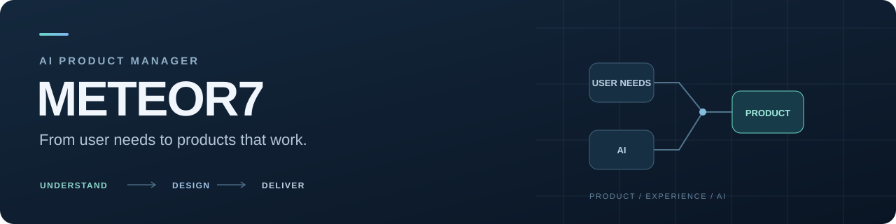

  

# 刘诺达 · Meteor7

**AI 应用开发 / 企业内部系统 / 业务需求到实际交付**

2026 届计算机科学与技术本科。目前主要参与半导体设备企业的 CRM、ERP/OA 与 AI 应用建设，使用 Claude Code、Codex 辅助开发，并负责需求分析、功能实现和交付验证。

我关注的是：把业务流程梳理清楚，让系统真正被使用，并对权限、数据质量和运行结果负责。

---

## 项目一览

| 项目 | 我的职责 | 已落地成果 |
| :--- | :--- | :--- |
| **企业 CRM** | 主导 0-1 建设、业务流程设计与 AI 辅助开发 | 约 **1.5-2 个月**完成首版上线，**15 人**内部使用 |
| **ERP/OA · 发票识别与报销** | 参与整体需求调研，主要负责发票报销模块 | 财务及采购部门使用，每月处理 **100+ 张发票** |
| **DINA 教育系统** | 产品设计、认知诊断模型与前后端实现 | 覆盖 **5 个班级、200+ 名学生** |

> 企业项目源码目前保存在私有仓库。本页展示业务场景、本人职责与交付结果。

## 技术与工具

**开发**：Python · SQL · Vue · TypeScript · Frappe  
**工程环境**：Linux · Git · Docker · CI  
**AI 与识别**：Claude Code · Codex · PaddleOCR · Skill / MCP

---

关注企业内部 AI 应用、AI 辅助研发与业务系统交付。
